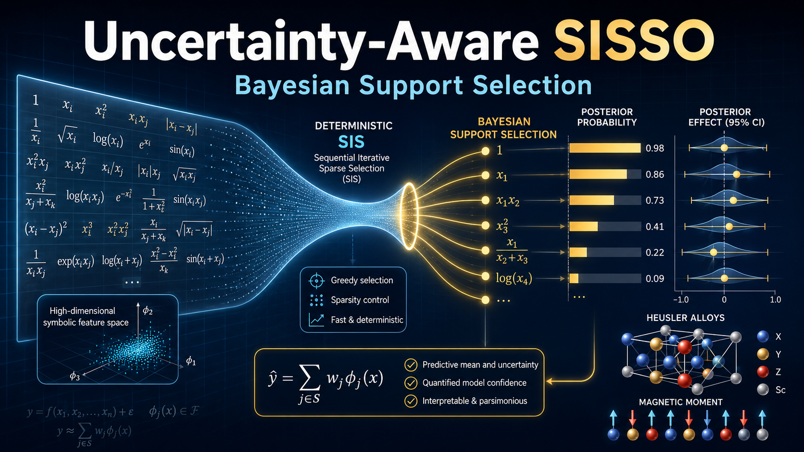

# Uncertainty-Aware SISSO: Bayesian Support Selection

This repository contains the Heusler-alloy training data, deterministic SISSO outputs, and Python code for conditional Bayesian analysis of screened symbolic supports.



## Repository layout

```text
.
├── README.md
├── Thumbnail.png
├── requirements.txt
├── run_analysis.py
├── SISSO-2D/
│   ├── train.dat
│   └── SISSO.out
├── SISSO-3D/
│   ├── train.dat
│   └── SISSO.out
├── bayes_so2/
│   ├── __init__.py
│   ├── io.py
│   ├── models.py
│   └── utils.py
└── analysis/
    ├── support_inference.py
    ├── symbolic.py
    ├── full_data.py
    ├── nested_cv.py
    ├── nested_diagnostics.py
    └── synthetic_test.py
```

## Dependencies

Use Python 3.9 or newer. Install the Python packages:

```bash
python -m pip install -r requirements.txt
```

Install a compatible **SISSO 3.5** executable separately, including its compiler/MPI runtime dependencies. The executable must be runnable directly from the command line. Supply its absolute path in the commands below.

## Dataset

Each SISSO directory contains only `train.dat` and `SISSO.out`. The training files contain compound identifiers, magnetic moments, and elemental primary features. The deterministic output files record the selected expressions, coefficients, and calculation settings. The source materials database is cited in the paper.

The complete screened symbolic space is not contained in `SISSO.out`. The runner regenerates it with SISSO before performing Bayesian inference. The original SISSO input settings are embedded in `run_analysis.py`; input files and all analysis results are generated when the script runs.

## Run the Bayesian analysis

Run from the repository root:

```bash
python run_analysis.py --sisso-executable /absolute/path/to/SISSO
```

This generates the screened spaces and runs the full-data Bayesian analysis for both descriptor dimensions. To run a single dimension:

```bash
python run_analysis.py --dimension 2 --sisso-executable /absolute/path/to/SISSO
```

The script writes generated SISSO files under `results/sisso/` and posterior summaries, ranked supports, feature inclusion probabilities, and predictions under `results/full_data_posterior/`. These predictions use the full training dataset; held-out predictions require the validation command below. No precomputed Bayesian results are distributed.

Completed full-data SISSO runs with matching inputs are reused. Add `--force` to regenerate them, or `--output /path/to/new/results` to use a separate output directory. Feature IDs are local to each generated run; compare expression strings across runs.

## Run fold-local validation

To repeat five-fold validation with symbolic screening performed separately inside each training fold:

```bash
python run_analysis.py --mode nested --sisso-executable /absolute/path/to/SISSO
```

This also runs the full-data analysis. Fold records, posterior summaries, and held-out predictions are written under `results/`. Completed folds are resumed unless `--force` is supplied. Symbolic feature generation can take substantial time, and exact three-dimensional support enumeration requires substantial memory.

## Run synthetic tests

The prescribed-candidate synthetic check does not require a SISSO executable:

```bash
python run_analysis.py --mode synthetic
```

To run the full-data analysis, fold-local validation, and synthetic tests together:

```bash
python run_analysis.py --mode all --sisso-executable /absolute/path/to/SISSO
```

## Citation

If you use this code or data, please cite:

[Uncertainty-Aware Symbolic Regression through Bayesian Support Selection](https://arxiv.org/abs/2606.04042)

```bibtex
@misc{bhattacharjee2026uncertainty,
  title={Uncertainty-Aware Symbolic Regression through Bayesian Support Selection},
  author={Bhattacharjee, Satadeep},
  year={2026},
  eprint={2606.04042},
  archivePrefix={arXiv},
  primaryClass={cond-mat.mtrl-sci},
  url={https://arxiv.org/abs/2606.04042}
}
```
